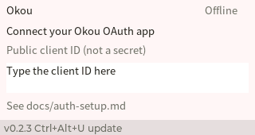
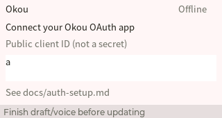
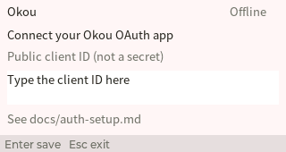

# Signed updater acceptance, 2026-11-17

## Published baseline

- Release: https://github.com/e7h4n/okou-zero/releases/tag/v0.2.2
- Source: `0af328652ccca8f91181078a9d06de2552935560`, based on the merged native V1 client, not the old Hello World client.
- Successful tag CI: https://github.com/e7h4n/okou-zero/actions/runs/44074006787
- Both native amd64 and native arm64 jobs built, ran protocol/UI/updater tests, packaged, installed, rendered the packaged UI, and removed the package successfully. Release publication depended on both jobs.
- Downloaded published manifest, detached signature, package and SHA256SUMS independently after publication. All hashes and the RSA/SHA-256 signature verified against the committed public key.
- Public-key DER SHA-256: `6c20694295871b5672a88a359259dac87d3b7820d22246f34fed70c54c4c21f4`.
- The obsolete `v0.1.4` run was cancelled; `v0.2.1` failed a protected-file metadata smoke-test check. Neither published a release. The check was fixed to use privileged `stat`; tags were not moved.

## Behavior and software checks

- Background startup check and automatic signed download, without blocking UI input.
- Only Ctrl+Alt+U requests installation; repeated keydown does not trigger it.
- Active work, voice capture, pending/uncertain sends and drafts in current or other threads defer installation.
- Installation waits through process interruption; successful replacement restarts the same executable with the original arguments, without rebooting the device.
- Local desktop CTest: 18/18; device-backend build: passed; Python updater/security tests: 27/27. The GitHub job supplies the native ARM64 execution evidence.
- Independent source reviews covered privilege/signature handling and native event-loop/process integration; identified installation-lifecycle issues were fixed before publication.
- `scripts/test-root-update.py` additionally exercises the **actual installed root helper and dpkg** on a disposable host. It creates an ephemeral TEST signing key, installs a signed next-patch fixture, rejects package tampering, same-version reinstall and downgrade, and restores the production PUBLIC key. It never uses the production signing secret or a release endpoint.
- That privileged smoke test passed locally against the CI-built amd64 0.2.2 package and on **both native CI architectures** ([run 44075296594](https://github.com/e7h4n/okou-zero/actions/runs/44075296594)), then again in the 0.2.3 release CI. The fixture changes Debian version metadata only, not the binary's compiled version, and is removed afterwards. Its fixture version is not a separately published package.

## Physical Cardputer acceptance, connection restored

The user requested deployment after restoring connectivity. The following software paths passed on the actual Debian ARM64 Cardputer, using `/dev/fb0` and its real evdev keyboard device:

1. Inspected installed 0.1.3, processes and active launcher before mutation. Verified the published 0.2.2 manifest signature and payload hash on the device, then bootstrapped 0.2.2 through apt. The SSH exec timed out after package configuration, so installation was **not replayed**: a separate state inspection confirmed 0.2.2, no remaining apt/dpkg process and a clean package audit.
2. Opened Okou through the launcher. Native 320×170 framebuffer rendered the initial OAuth setup page without the old allocation freeze. Typed a harmless test character, erased it without saving, and verified Esc returned to the launcher.
3. Published [0.2.3](https://github.com/e7h4n/okou-zero/releases/tag/v0.2.3), built from `63f2ce2`. [Tag CI](https://github.com/e7h4n/okou-zero/actions/runs/44080309931) passed native ARM64 and amd64 tests, including real privileged fixture installations, before signing/publication. This release advances the version only; the updater implementation is unchanged.
4. Relaunched 0.2.2. It independently fetched and verified the real 0.2.3 release and displayed `v0.2.3 Ctrl+Alt+U update`. Package version remained 0.2.2 while waiting for confirmation.
5. Typed an unsaved test character, then injected Ctrl+Alt+U: the UI displayed `Finish draft/voice before updating`, and package version/process remained unchanged. Cleared the input. Ctrl+U without Alt also did not install.
6. Injected Ctrl+Alt+U exactly once with no outstanding input. Captured `Updating... Do not power off`. Package and CLI advanced to 0.2.3; the app automatically re-executed with the **same PID** and its `/proc/PID/exe` inode matched the newly installed binary. The launcher PID was unchanged at the immediate post-install check.
7. Verified current-version Ctrl+Alt+U did not reinstall, Esc returned to the launcher, and 0.2.3 could be opened again. Final process executable matched the installed file; `dpkg --audit` was clean. Reverified the cached production-signed manifest and complete payload after installation. Cache directory/file modes were 0700/0600.
8. Compared actual boot-ID contents before/after: unchanged. No device compilation, system reboot or network-security changes were performed by this task.

### Scope and recovery observation

- Input was injected through the **real evdev channel**, not physical finger presses. Screenshots below are actual RGB565 framebuffer reads, not headless renders, camera photographs or a separate Linux desktop. Physical key-switch behavior and LCD viewing quality are not claimed.
- The OAuth client is not configured. Login, authenticated chat, Project, realtime and microphone/voice were **not** accepted. The setup-page unsaved-input guard passed; active-voice/hidden-chat-draft guards retain their automated-test coverage, not physical-device coverage.
- A separate project conversation briefly operated the same device during initial launch checks and then stopped at 20:06. The signed update acceptance was performed afterwards; overlapping launcher-navigation observations are not used to prove chat or physical-key correctness.
- After the successful upgrade and exit, further launcher/Settings navigation included a four-second Esc hold. At 20:18:37 the launcher exited with status 75 and systemd restarted it once. Upstream [`EscUiWatchdog`](https://github.com/CardputerZero/launcher/blob/master/projects/APPLaunch/main/ui/esc_ui_watchdog.cpp) uses exit 75 for its armed long-Esc recovery (threshold 3500 ms in the corresponding header), consistent with that action. This was outside the completed upgrade; no system reboot occurred. Do not interpret the immediate post-install unchanged-launcher check as a claim that the launcher never restarted during the entire later navigation session.

### Framebuffer evidence

| Ready, package still 0.2.2 | Unsaved input blocks installation |
| --- | --- |
|  |  |

| Explicit installation | Reopened installed 0.2.3, unconfigured OAuth |
| --- | --- |
|  |  |
